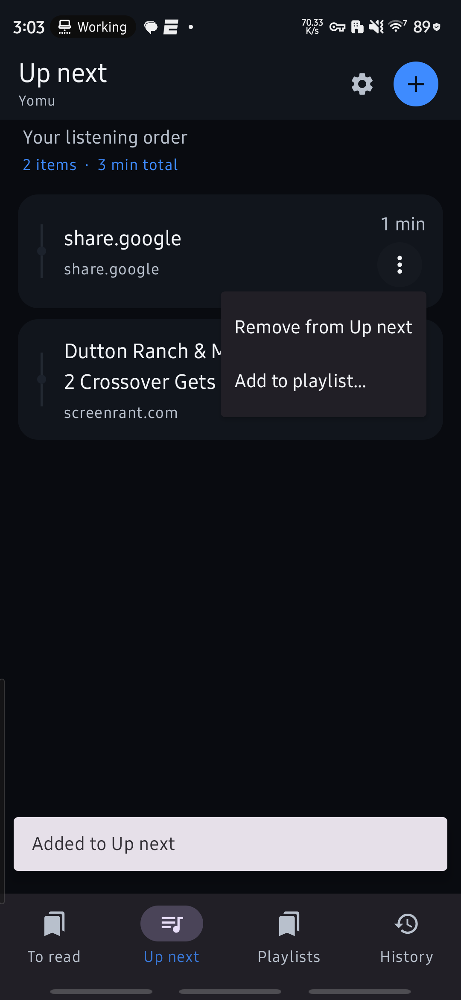
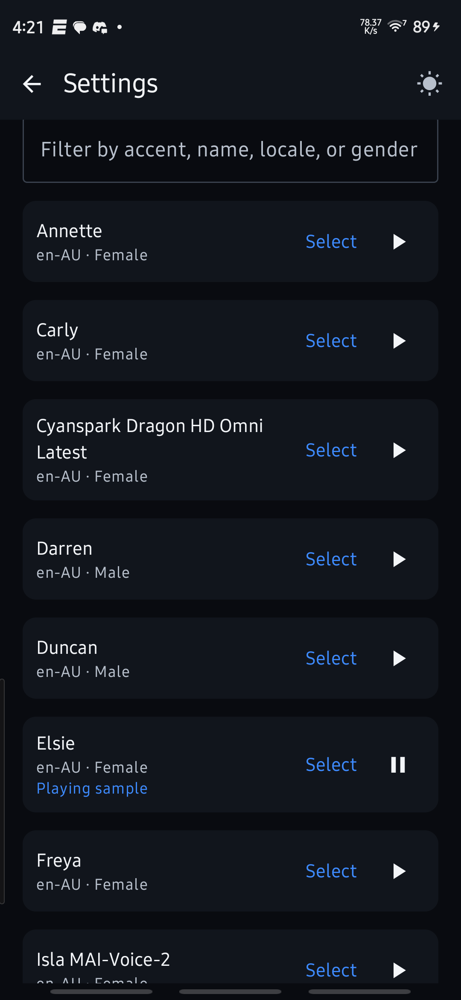

# Yomu

**Yomu** is a native Android reading and listening library. Share articles, PDFs, Word documents, or other supported files into the app, organize them for later, and listen with online or local text-to-speech while the current sentence is highlighted.

> **Project status:** active personal V1 development. The app builds as a debug APK for private sideloading. This is not a Play Store release. Some features have been exercised on the target Galaxy; the production app still needs further end-to-end device verification. See [Build status and limits](android/BUILD-AND-LIMITS.md) and [Spike results](spike/SPIKE-RESULTS.md).

## Screenshots

### Up next

Items in Up next play in order and advance automatically. A short tap from To read adds an item; long press starts it immediately.



### Voice selection

Browse available voices, filter the list, choose a voice, and play a sample before selecting it.



## What Yomu does

- Accepts shared public article URLs, PDFs (including scanned and mixed pages), Word documents, and plain text into **To read** without starting playback.
- Organizes items across **To read**, **Up next**, custom playlists, and **Read history**. An item may appear in multiple playlists while sharing its reading position.
- Reads aloud with sentence highlighting, tap-to-seek, adjustable speed, previous/next controls, sleep timer, elapsed/remaining time, and background media controls.
- Supports Android Auto's driver-safe media browser for To read, Up next, and playlists, with spoken-item selection and sentence skip controls. Device/head-unit validation is pending; see [Build status and limits](android/BUILD-AND-LIMITS.md).
- Uses user-configured online speech providers with a separately selected local Kokoro voice as an offline fallback. API keys are stored locally using Android Keystore-backed encryption. Yomu does not depend on Google or Samsung system TTS.
- Exports an individual item as one MP3 with ID3 chapter marks for listening in compatible players such as Pocket Casts.
- Keeps the library and settings on the phone, with manual backup and restore.

Online services require the user's own account and API key. Free allowances, voice availability, and paid-use rules vary by provider and can change. Yomu displays provider limits where known; the user should check current provider terms and usage before enabling synthesis. Article/document text is sent to the selected provider when online speech is used.

## Technology

The production app is a native Kotlin application using Jetpack Compose and Material 3. Room stores the library and playback state; DataStore holds preferences; Media3 handles playback and Android media controls. WorkManager runs retryable URL imports. OkHttp, Readability4J, and jsoup support article retrieval and extraction. Android PDF APIs, bundled English Tesseract OCR, and Apache POI handle document extraction. Online speech providers are called through their REST APIs. Local Kokoro speech uses sherpa-onnx with eSpeak-NG pronunciation data. MP3 export uses the replaceable LAME encoder.

The production project is in [`android/`](android/). The earlier feasibility and device-validation app remains in [`spike/`](spike/); its results are evidence about those focused prototypes, not automatic proof of equivalent production behavior.

## Build and install

For a ready-to-install private sideload build, download the APK attached to a versioned [GitHub release](https://github.com/dave-patrick/yomu/releases). Each published app release includes its source tag and matching debug APK.

Requirements: Windows with Android Studio or a compatible Java/Android SDK setup, Android SDK/NDK versions declared by the Gradle project, and an arm64 Android device for on-device use.

```powershell
cd android
.\gradlew.bat :app:assembleDebug
```

The APK is created at `android/app/build/outputs/apk/debug/app-debug.apk`. It is debug-signed for personal development and sideloading. To run local unit tests:

```powershell
.\gradlew.bat :app:testDebugUnitTest
```

With a device connected, run instrumentation tests using:

```powershell
.\gradlew.bat :app:connectedDebugAndroidTest
```

See [Android build notes](android/BUILD-AND-LIMITS.md) for installed behavior, limits, device-test status, and release considerations.

## Project guide

- [Roadmap](ROADMAP.md) — phased next work and acceptance gates.
- [Web reader and settings design](docs/WEB-READER-DESIGN.md) — planned web reading, settings ownership, progress sync, and audio architecture.
- [Product scope and principles](PRODUCT.md) — requirements, V1 boundaries, and user-facing behavior.
- [Pre-development proposal](YOMU-PRE-DEVELOPMENT-PACKAGE.md) — architecture, technology choices, libraries, licensing, and milestones.
- [Build status and limits](android/BUILD-AND-LIMITS.md) — build commands, current implementation, test coverage, limitations, and private-sideload posture.
- [Screen brief](android/SCREEN-BRIEF.md) — UI structure and interaction direction.
- [Spike results](spike/SPIKE-RESULTS.md) — focused prototype tests, device observations, and remaining checks.
- [License bill of materials](spike/LICENSE-BOM.md) — native and transitive component license audit.
- [Spike app and setup](spike/README.md) — prototype layout and tools.

## Privacy, keys, and licensing

Provider keys and local configuration must never be committed. Put machine-specific settings in ignored local files; the Azure key file, Android `local.properties`, generated outputs, exports, and device captures are excluded by `.gitignore`. Do not add signing keys, personal backups, or API credentials to the repository.

Yomu uses open-source or freely licensed components. The app currently includes GPL-licensed eSpeak-NG pronunciation resources and an LGPL-licensed LAME encoder. See the [license BOM](spike/LICENSE-BOM.md) and the license notices shipped in `android/app/src/main/assets/licenses/`. This project is not yet prepared for public distribution; release packaging, source/relinking obligations, asset provenance, signing, and complete device QA require review before such a release.

## Working name

“Yomu” (読む) is the current working name, from the Japanese verb meaning “to read.”
