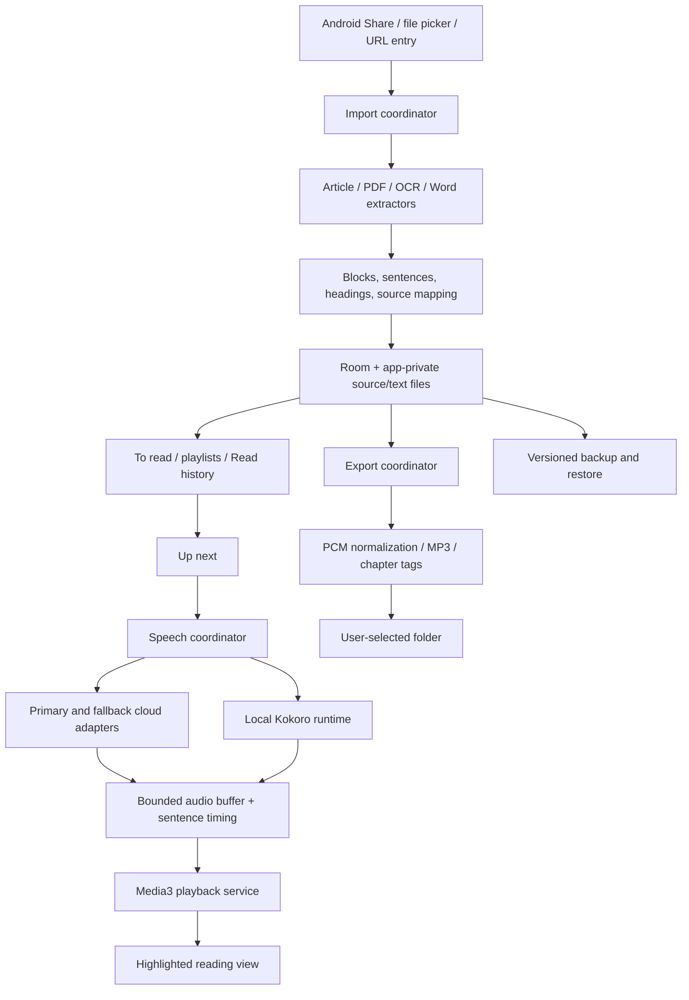

# Yomu — Pre-development proposal and implementation plan

Prepared: October 1, 2026  
Status: V1 implementation in progress; the native Android app, core library/settings UI, extraction, online/offline speech, Media3 playback, export, backup, and OPML paths are implemented. The current debug APK builds and JVM tests pass; full target-phone V1 acceptance and release packaging remain open.  
Primary target: User's Samsung Galaxy S26 Ultra, reported One UI 9 / Android 17  
Delivery: Downloadable, signed Android APK

Update, October 2, 2026: Focused diagnostics cover target-device local Kokoro TTS, Media3 lifecycle, the two article extractors, Azure SDK and REST alignment, incremental sentence playback, Pocket Casts chapter import, PDF/OCR and DOCX fixtures, and actual network-loss fallback plus both recovery policies. The audited sherpa/eSpeak source-built JNI has replaced the prebuilt library in the Spike APK, and Kokoro generation and playback passed on the phone. An English-only eSpeak data subset of 838,291 bytes (95.34% smaller than the full payload) synthesized successfully on the target phone without eSpeak voice-variant files; all 11 packaged Kokoro voices passed a varied-English synthesis corpus using it. Kokoro v0.19 model/voice provenance and local hashes are recorded. The user auditioned the longer REST sentence-chunk voice and said it sounded good. See [spike results](spike/SPIKE-RESULTS.md) and [license BOM](spike/LICENSE-BOM.md). The production app now builds with its V1 screens and integrations; remaining gates include broad document/device QA, service-kill/resume verification, custom provider extensibility, final attribution/source distribution, and release signing.

## 1. Purpose and constraints

Yomu turns documents and public web articles into speech, allowing the user to collect material now and listen later. The central experience is streaming read-aloud with sentence highlighting in a clean reading view. Generating a complete MP3 is a separate, important feature.

The app must work without a paid subscription, paid development library, proprietary paid OCR service, or home server. All bundled tools, libraries, and model assets must be open source or freely licensed for the intended distribution. Optional commercial cloud speech integrations are permitted when the user supplies credentials. They are never required for the offline reading path.

The phone's Samsung and Google TTS engines will not be used. An app-managed offline model provides speech independently of the system TTS engine. Initial reading language is English. Listening volume varies from under 30 minutes to well over 90 minutes on a given day, so finite cloud allowances cannot be the only available speech path.

The working name is Yomu. Naming/trademark availability has not been investigated; the name is provisional.

## 2. Agreed product scope

### 2.1 Import and content preparation

- Receive public URLs, PDFs, and Word documents from Android's Share menu.
- Provide an in-app file picker and URL-entry action as convenient equivalents.
- Shared items land in **To read**, never automatically begin playback.
- Immediately save the imported document or extract and save the public article's readable text when connectivity permits.
- When a URL is shared offline, retain the URL in a pending import and retry extraction later. Unfetched text cannot be made available offline.
- Support selectable-text, scanned, and mixed PDFs. Run local OCR where usable text is absent.
- Prompt for passwords for supported protected PDFs. Do not bypass protection.
- Support DOCX and legacy DOC. The production Android app now uses Apache POI HWPF for `.doc`; ordinary-document extraction and dependency compatibility require target-device instrumentation.
- Remove repeated headers and footers from narration by default.
- Make footnote narration optional; default off is a proposed default.
- Preserve headings for navigation and MP3 chapter creation.
- Read OCR output as extracted in version one; an extracted-text editor is out of scope.
- Preserve source title, URL or filename, import date, and extraction warnings.

Broad PDF support is a goal, not a guarantee that damaged files, poor scans, handwriting, or every complex layout will yield correct reading order. Import failures must be visible and recoverable. Tables remain a technical/product decision: the proposed default is row-oriented narration with warnings when order is uncertain, pending user review.

### 2.2 Library, playlists, and queues

| Area | Behavior |
|---|---|
| To read | Default inbox for new items; no automatic playback |
| Custom playlists | Named collections for future listening; user can move or add items from To read |
| Up next | Ordered active playback queue; automatically advances after an item finishes |
| Read history | Completed items retain text and progress; entries can be individually removed or history cleared |

- One item may appear in several playlists with one shared reading position.
- Short tap on a library/playlist item adds it to Up next.
- Long press plays it immediately.
- Both gestures also have explicit accessible buttons/menu actions.
- Offer manual ordering and date-added sorting in To read; estimated-duration sorting and visible estimates remain available in Up next.
- Keep estimated times off the To read list so its items stay focused on reading progress and source.
- Offer configurable swipe-right and swipe-left actions on library items, with queue, play-now, playlist, and off choices.
- Removing playlist membership does not delete the underlying document.
- Clearing history should clear completion/history entries rather than silently deleting all saved documents. A separate explicit delete action handles source/text deletion; this distinction is a proposed default.

Play now behavior: save the interrupted item's position, play the chosen item, then resume the interrupted item before continuing Up next. Avoid automatically enqueuing duplicate copies of the same item. The production path now persists the return point and has focused state tests; the end-to-end service flow still needs target-phone validation.

### 2.3 Reading and playback

- Clean, reflowed text view with the current sentence highlighted and optional automatic scrolling.
- Tap a sentence to start there; previous/next sentence controls.
- Play/pause, seek, adjustable speed, sleep timer, and persistent resume position. A position slider shows and seeks the sentence position; a separate speed button opens the speed slider.
- Display total duration, elapsed duration, remaining duration, percentage, and a progress bar; visibility is configurable.
- Proposed default display: elapsed and remaining time, plus progress bar.
- Clearly distinguish estimated times from measured audio times.
- Adjust remaining listening-time estimates when speed changes.
- Continue reading with the screen off; expose lock-screen/notification controls and Bluetooth headset controls.
- Handle audio focus, calls, headset disconnection, and other audio interruptions using Android media conventions. If a supported phone silences audio without sending a usable audio-focus event, offer call-state detection behind an explicit setting and Android's `READ_PHONE_STATE` permission; read only ringing/off-hook/idle state, never caller numbers or call history.
- Save progress on pause, sentence transition, interruption, and service shutdown; recover after process death.

Elapsed position and duration should primarily represent the content timeline; remaining wall-clock listening time accounts for playback speed. If an actual-session listening-time display is added, label it separately so rewinds do not make the content position ambiguous.

### 2.4 Speech providers and voices

- Preconfigured provider adapters: user enters credentials rather than building requests manually.
- Retrieve all API-exposed voices available to the user's account, with pagination where required.
- Each voice row has a sample/play button and selection action.
- Offer favorites and filters for language, accent, gender/presentation, and other provider-supplied attributes.
- Do not invent attributes when the provider omits them; allow personal tags for qualities such as calm or mature.
- User preferences: Australian, New Zealand, British, Scottish, and Irish accents; American is acceptable. Male and female voices are both useful. Avoid making youthful or exuberant styles the default.
- Choose a primary online provider/model/voice and ordered online fallback selections.
- Choose a separate offline voice.
- Offer an Offline only mode that skips cloud speech requests.
- On service loss, exhaustion, or failure, try eligible online fallbacks, then local speech.
- When switching offline, play an app-generated local announcement such as: "Online speech is unavailable. Switching to your offline voice."
- Never rely on a failing online provider to generate the fallback announcement.
- Recovery behavior is configurable: keep the current fallback voice until the item finishes, or return to the primary at the next safe sentence boundary. Proposed default: finish with the current fallback voice.
- Show free allowances, reset rules, request/rate limits, model eligibility, and potential billing conditions.
- Paid use requires explicit opt-in in Yomu. Cloud-account settings remain authoritative; the app cannot guarantee that an arbitrary supplied key is configured as free-only.
- Voice samples use existing provider previews when available; generated previews must disclose allowance consumption and be cached.

### 2.5 Export and backup

- Export an individual reading item as **one MP3** into a user-selected folder.
- Add numbered ID3 chapters at roughly 1,000-word boundaries so the file offers reliable chapter skipping in Pocket Casts even without source headings.
- Include title and source metadata; use a safe, readable filename.
- MP3 export is independent of listening and need not begin automatically at import.
- Default export uses one selected provider/voice throughout; pause/resume rather than silently mix fallback voices in the exported file. This is a proposed default for consistent recordings.
- Support export progress, cancellation, restart/recovery, and clear free-quota estimates before large jobs.
- Initial Pocket Casts integration is manual local-file import. Automatic folder pickup, cloud upload, and private podcast feeds are deferred.
- Phone-only data in version one; manual full backup and restore.
- Backup includes saved text, source files, playlists, queue, history, reading positions, and preferences. Optional audio-cache inclusion can be decided by available space.
- API keys are excluded from ordinary backups by default and must be re-entered after restore.
- OPML import and export are available as a supplemental URL-list format; it cannot represent a complete document library, so manual Yomu backup remains the full backup path.

### 2.6 Appearance

Use Material Design through Compose Material 3. Offer light, dark, and follow-system modes plus user-selectable accent colors. Initial dark appearance may use charcoal with bright blue accents, while preserving accessible contrast. The user's later Material Design request replaces the earlier fixed palette requirement.

## 3. Proposed technology stack

Use native Android/Kotlin rather than a cross-platform framework: this app depends heavily on sharing, foreground media services, native inference, document handling, and storage access.

| Layer | Proposed technology | License / selection status |
|---|---|---|
| Language/build | Kotlin, Gradle Kotlin DSL, Android Gradle Plugin, free Android SDK/NDK tools, OpenJDK | No paid tool required; exact stable versions selected and pinned during setup |
| UI | Jetpack Compose, Material 3, Navigation Compose, lifecycle ViewModels | AndroidX Apache 2.0; recommended [S1] |
| Async/state | Kotlin coroutines and Flow | Proposed; audit exact artifacts and notices |
| Structured storage | Room with migrations and full-text search where appropriate | AndroidX Apache 2.0 [S1] |
| Preferences | DataStore | AndroidX Apache 2.0 [S1] |
| Media | Media3 ExoPlayer, MediaSessionService, MediaSession | Background media architecture documented by Android [S2] |
| Background preparation | WorkManager for resumable imports/OCR; appropriate foreground execution for long user-initiated exports | Android scheduling rules determine final job design [S3] |
| HTTP | OkHttp with explicit timeouts and credential-redacted logging | Apache 2.0 candidate; pin and verify canonical release origin before use [S4] |
| Serialization | kotlinx.serialization | Proposed; exact dependency audit at setup |
| HTML handling | jsoup for parsing, cleaning, and metadata | MIT candidate [S5] |
| Article extraction | Current Mozilla Readability in an isolated local WebView, with Kotlin normalization | Apache 2.0 [S6]; prototype local DOM integration |
| Article alternative | Readability4J | Apache 2.0 Kotlin port, but older upstream baseline; comparator rather than automatic first choice [S7] |
| PDF text/rendering | Android PdfRenderer text extraction, rendering, and password load APIs on supported API levels | Selectable/scanned/mixed/password-protected fixtures passed on API 37; text/password APIs require API 35+, so older-version compatibility needs a separately licensed PDF backend [S8] |
| OCR | Tesseract4Android plus English trained data | Target-phone basic OCR passed. Wrapper/engine Apache 2.0; exact arm64 native closure now mapped to Tesseract Apache 2.0, Leptonica BSD-2-Clause, IJG's custom permissive terms, and libpng License v2; include all required notices [S9] |
| DOCX | Small bounded ZIP/XML reader for paragraphs, headings, and tables | App-owned prototype passed a paragraph/table reading-order fixture on the target phone; footnotes, revisions, embedded objects, and diverse Word producers remain to validate |
| Legacy DOC | Apache POI HWPF isolated behind DocumentExtractor | Apache 2.0 candidate; Android method compatibility and dependency-size gate [S10] |
| Offline TTS | sherpa-onnx Kokoro backend behind `OfflineSpeechProvider`, with its integrated eSpeak-NG front end for v1 | Known-working path measured on target phone; user accepts GPL, with notices/source obligations to resolve for release. Kokoro v0.19 assets are Apache-2.0 with retained notice and pinned source provenance. A candidate English phonemizer data subset measured 838,291 bytes on the target phone and passed varied-text synthesis using all 11 bundled Kokoro voices without eSpeak voice-variant files; pronunciation-quality review remains before shipping. sherpa currently does not expose external phoneme injection in this Kotlin path, so Misaki (Apache 2.0) needs that capability verified or a different backend before it can replace eSpeak. |
| Cloud TTS client | Provider interface with OkHttp REST adapters; Azure SDK remains in the diagnostic Spike as a comparator pending redistribution/license resolution | REST voice discovery and synthesis are verified; sentence-level timing was derived from PCM durations and validated on-device in both a concatenated WAV and incremental Media3 playback. REST has no word callbacks. |
| MP3 encoding | LAME encoder through a small NDK/JNI wrapper | LGPL candidate; distribution obligations and encoder-only build gate [S14] |
| MP3 chapters | App-owned ID3 CHAP/CTOC writer or audited small library | Standard exists; test timestamp correctness and player compatibility [S15] |
| Files/secrets | Storage Access Framework, app-private files, Android Keystore | Platform APIs; no broad storage permission required by design |
| Tests | JUnit, Android instrumentation, Compose UI tests, HTTP test fixtures | Free tooling; exact versions pinned with the app |

Cloud speech uses an app-owned capability-based provider interface and open-source HTTP client (OkHttp) for REST adapters. Azure REST currently leads as the app candidate: a sentence is synthesized to a temporary private-cache file, the Media3 queue starts after a two-sentence prebuffer, and later sentences are synthesized and appended in the background. On the test article, first playable audio was queued in 2.82 seconds and the user reported that the incremental sentence joins sounded good. It provides sentence-level, not word-level, highlighting. The Azure SDK stays in the Spike for comparison while its proprietary redistribution terms are reviewed against GPL distribution; the PCM WAV test did not load its SDK native libraries. Audit cloud client licensing separately from the remote Azure service's limits and terms.

No paid PDF SDK, cloud OCR requirement, analytics SDK, subscription backend, or mandatory hosted service is proposed. Android Studio is optional; a command-line Gradle build should also work.

Use manual constructor dependency injection initially to keep the graph explicit. Introduce a DI framework only if the implementation warrants it.

### Licensing gate

Top-level repository licenses do not establish the license of every bundled artifact. Record the source, version, checksum, license, notices, and redistribution requirements of all binaries, model files, voice assets, dictionaries, and trained data. Supply a third-party notices screen and distribution files.

The v1 Spike uses eSpeak NG for Kokoro pronunciation; its GPL terms are accepted for this project, with source and notice obligations to satisfy before APK release [S16]. Misaki is a later alternative experiment, not a v1 dependency. LAME also has LGPL obligations and warns about GPL decoding code [S14]. Audit the exact native build and document the distribution strategy. No app-source license is selected by this proposal.

## 4. Online provider shortlist and limits

Research checked October 1, 2026. Limits are provider policy, not permanent app constants. Show a last-verified date and authoritative link in provider settings. Exact request-size, concurrency, reset, and voice restrictions must be recorded per adapter before release.

| Provider | Published free allowance | Practical proposal |
|---|---|---|
| Azure Speech F0 | 500,000 neural TTS characters/month; documented F0 TTS rate limit 20 transactions per 60 seconds [S17, S18] | First free-tier integration candidate; setup needs key plus region/endpoint, so it is not literally key-only |
| ElevenLabs Free | 10,000 credits/month; conversion from characters to credits depends on model. API generation draws from the account's allowance [S19, S20] | Second adapter, voice-quality audition candidate; long-document use may exhaust the free allowance quickly |
| Custom endpoint | No universal allowance or voice catalog | Support defined compatible API profiles; endpoint URL, authentication, and optional model/voice metadata settings |

Neither cloud service is open source; these are optional remote integrations explicitly allowed by the user. The bundled application and offline functionality must remain usable without them. Additional providers can be added after confirming a genuine recurring free TTS API allowance rather than a promotional trial or demo website.

Do not label ElevenLabs objectively "best": select narration quality through actual samples. Azure's larger published allowance makes it a practical starting candidate, not proof of superior voice quality.

Free-use controls:

1. Query account usage where a supported API exists.
2. Otherwise show a local estimate clearly labeled as such; other clients can consume the same account allowance.
3. Rate-limit requests per adapter; respect retry information and provider quotas.
4. Require confirmation of free-tier configuration during setup; avoid silent switching to billable models.
5. Detect quota exhaustion separately from transient network errors and unsupported voices.
6. Estimate export consumption before generation and avoid automatic expensive retries.
7. Never promise universal prevention of charges from an externally configured paid account.

## 5. Architecture and data flow

### Module boundaries

Start with one app module and clear packages; split the heavy native components into separate Gradle modules when needed. Avoid creating many empty modules.

- `library`: documents, playlists, history, search, queue operations.
- `importing`: share intents, MIME detection, source copying, extractors, OCR jobs.
- `content`: normalized blocks, sentence splitting, heading/footnote policies.
- `speech`: provider interface, catalogs, usage policy, fallback coordinator.
- `offline`: native runtime and model installation.
- `playback`: Media3 service, session commands, sentence timing, progress.
- `export`: complete audio generation, encoding, tags, output lifecycle.
- `backup`: versioned manifests, checksums, restoration and migration.
- `settings`: theme, voices, credentials, preferences, storage controls.

### Core entities

| Entity | Main fields / role |
|---|---|
| ReadingItem | ID, title, source type/reference, import state, timestamps, normalized-content version |
| ContentBlock | Ordered heading/paragraph/table/footnote block, source page and provenance |
| Sentence | Stable ID, block, text range, narration-enabled flag; offsets refer to normalized content |
| Chapter | Source heading/title, first sentence ID, export timestamp when known |
| Playlist / Membership | Playlist metadata and many-to-many item membership with ordering |
| QueueEntry | Item reference and position; active queue persists across restarts |
| ReadingProgress | Item/content version, sentence ID, intra-sentence offset, completion state |
| HistoryEntry | Completion/listening event; independent of source deletion |
| ProviderConfiguration | Endpoint/region/model, selected voice, eligibility and credential reference |
| VoiceMetadata | Provider voice ID, attributes, favorites/tags, preview reference |
| AudioSegment | Content hash, provider/model/voice/settings, sentence range, audio/timing reference |
| ExportJob | Item version, chosen voice, status, generated segments, destination, errors |

Separate sentence identity from provider request identity. One request can contain multiple sentences; otherwise an Azure free account could hit the request-rate ceiling during ordinary narration.

## 6. Extraction implementation

### URLs

Fetch with a bounded HTTP client; preserve redirect destination and source metadata. Parse HTML, remove executable content, and extract the main article. Run Readability only against a local sanitized document in a restricted WebView; do not expose native bridges to arbitrary site scripts. JavaScript-heavy sources may require a separately constrained rendering fallback, which must be tested rather than assumed.

Normalize text into blocks without discarding headings. Remove navigation, advertisements, newsletter prompts, and unrelated links where extraction permits. Show extraction status and warnings, not an empty successful item. Do not support login/cookie import or paywall bypass in version one.

Required article fixtures:

- [TWZ F-47 article](https://www.twz.com/air/full-f-47-production-line-not-too-far-away-usaf-general)
- [9to5Google Facer article](https://9to5google.com/2026/09/30/facer-wear-os-library-update-timex/)

The research browser could access readable text on both pages; that does not validate the eventual Android extractor.

### PDFs

Process page by page. Extract native text first, assess usability, and OCR image-only or unusable regions/pages. Avoid duplicating existing text on mixed pages. Bound render resolution and memory; check cancellation between pages. Deskew/orient scans where feasible. Preserve page provenance for diagnostics.

Repeated-header/footer detection should use positional text repeated across pages rather than deleting every repeated phrase. Apply conservative confidence thresholds. Multi-column order, tables, captions, and footnote association require dedicated fixtures. Flag uncertainty rather than silently claiming accurate extraction.

### Word

For DOCX, parse bounded ZIP entries and XML with external entity resolution disabled. Preserve paragraph order, heading styles, simple tables, and footnote links. Reject archives exceeding safe resource limits with a useful explanation. Use POI HWPF for DOC only if the Android spike proves it works; otherwise document the blocker before promising legacy support in the release.

## 7. Speech, timing, and fallback implementation

The provider interface should expose capabilities: voice catalog, previews, synthesis, timing support, quota/usage retrieval, supported formats, request bounds, and cancellation. Do not require every provider to support every capability.

Chunk text at sentence boundaries into provider-sized requests. Buffer a few upcoming passages, with bounded disk/memory and one coordinated generation scheduler. Interactive playback has priority over export to avoid quota contention.

For providers with timing/alignment data, map returned boundaries to normalized sentence IDs. For providers without timing, evaluate sentence-sized generation where quotas allow; otherwise mark alignment approximate or add a tested local alignment solution. Accurate multi-sentence highlighting must be demonstrated before accepting an adapter as fully supported. Media playback position, rather than request completion time, drives highlighting.

On a seek, cancel obsolete requests and discard stale callbacks with a playback generation token. Switching voices invalidates audio prepared with the old voice. Cache keys include content version, voice, model, generation settings, and normalization version. Playback-speed changes should ordinarily use player time stretching rather than regenerate speech.

Fallback state machine:

1. Primary healthy: generate and play buffered passages.
2. Temporary failure: bounded retry with backoff; avoid exhausting the buffer with repeated failures.
3. Quota/permanent/configuration error: mark that provider unavailable for the relevant interval.
4. Try eligible online fallbacks in user order.
5. If none succeeds, announce offline transition locally and continue from the next unplayed sentence.
6. In offline mode, probe recovery sparingly; return according to the selected recovery policy.

An incomplete sentence may need replay from its beginning to avoid skipped words. Never silently skip a passage because generation failed. Distinguish loss of connectivity, quota exhaustion, provider errors, and invalid credentials in the UI. If the offline model is not installed or usable, pause with an actionable status.

### Offline model management

Download model and voice assets explicitly during setup, with progress, checksum verification, resumable download where possible, and available-space checks. The user's acceptable planning budget is roughly 200–500 MB; the final package size remains unmeasured. Download to staging, verify, then activate atomically. Do not overwrite a working model before the replacement is verified. Expose local voice previews and allow offline playback/export without API keys.

## 8. Duration estimates and playback UI

Before synthesis, estimate using normalized spoken word count and a calibrated baseline words-per-minute for the selected voice. Label the result approximate. After synthesis, use measured segment duration and retain estimates for the ungenerated remainder. Avoid implying that character quotas translate to exact listening minutes.

Use a persistent compact player plus a full reading screen. Lists show duration and reading progress. A chapter navigator appears only when headings exist. Voice/settings changes should show how they affect upcoming audio and avoid restarting the item unexpectedly.

Configure display of total, elapsed, remaining, and percentage. Reader settings also include font size, line spacing, sentence highlight appearance, and auto-scroll; these are proposed accessibility defaults rather than prior user decisions.

## 9. MP3 export and Pocket Casts

Generate normalized PCM at a consistent sample rate/channel layout, encode one MP3, and add title/source metadata and ID3 chapter/table-of-contents frames. Derive timestamps from encoded audio timing, accounting for encoder delay where relevant. Test chapter offsets against actual playback; do not use word-count estimates for exported chapter tags.

Export to a temporary private file first; publish only after successful encoding/tag validation. Resumable jobs should preserve already-generated segments without retaining unlimited storage. Export a stable content/settings snapshot so changes during generation do not corrupt the recording.

Pocket Casts documents local Android file import through Profile → Files → + [S21]. Chapter support and custom-file behavior require an actual Android test [S22]. Do not promise watched-folder import or private-feed integration in version one. A later private-feed feature would introduce hosting, reachability, and access-control decisions.

## 10. Privacy, storage, and backup

Documents stay local unless their text is sent to a chosen online speech provider. State that fact during provider setup. Keep API keys in Keystore-backed encrypted app storage; redact authorization headers and document text from routine logs. Permit deleting credentials and switching to fully offline operation.

Use app-private storage for sources/content and bounded audio cache. Expose usage by sources, models, cache, and exports. Clearing cache must preserve imported text and progress. Use the system document picker for export and backup destinations. Avoid broad file access permissions.

Full backup format: ZIP containing a versioned JSON manifest, normalized content, original files, playlist/queue/progress data, preferences, and file checksums. Exclude secrets and regenerable models by default. Restore into staging, validate schema/paths/checksums/size limits, then apply a transaction. Reject archive path traversal. First version may replace the library after explicit confirmation rather than attempt a complex merge; finalize the restore interaction before release.

Exclude secrets from Android automatic backup rules as well. Signing keys and passwords never belong in the repository or ordinary app backup.

## 11. Development milestones and acceptance gates

| Milestone | Deliverable | Acceptance gate |
|---|---|---|
| 0 — Integration spikes | Small Android test app and findings | **Partially complete:** real-device local speech/Media3, article comparison, Azure timing and incremental REST playback passed. Actual Wi-Fi+cellular loss fell back to Kokoro; both remain-offline and automatic sentence-boundary recovery policies completed the article. Selectable, scanned, mixed, and password-protected PDF fixtures passed on the Galaxy using platform text extraction plus Tesseract OCR; a realistic DOCX paragraph/table fixture passed and repeated header/footer text was excluded. The OCR and source-built sherpa native closures are mapped, and the source-built JNI now passes in the APK and on-device playback. Remaining: difficult/large PDF and legacy/complex Word fixtures, timeout/quota/auth failure cases, broader extraction/voice checks, verify production model/data licenses, and assemble GPL/LGPL source/notice materials |
| 1 — Library foundation | Import, content storage, lists/playlists/history | Share works; text persists offline; memberships share progress; queue survives restart; failed imports are recoverable |
| 2 — Speech/player | Offline + Azure + ElevenLabs/custom-profile adapters | Voice listing/previews, sentence seek/highlight, speed, background controls, quota behavior, fallback and recovery work |
| 3 — Export/backup | MP3 export and full backup/restore | One valid file, accurate chapters only when present, cancellation/recovery, Pocket Casts import test, restored positions and playlists |
| 4 — Release preparation | Signed APK, release notes, notices, build instructions | Install/update on target phone, no paid dependency, offline operation, key redaction, migration/backup checks |

Do not estimate a delivery date until milestone 0 identifies native/runtime and provider risks. Each milestone should produce an installable test APK where meaningful.

### Required test scenarios

- Import both supplied article URLs without navigation/ad contamination.
- Import DOCX, legacy DOC, selectable-text PDF, scanned PDF, mixed PDF, password-protected PDF, rotated scan, multi-column PDF, and a malformed file.
- Check repeated header/footer removal and optional footnotes against known fixtures.
- Listen to a long item with screen off; interrupt with call/audio focus and headset removal.
- Force network loss, provider timeout, invalid key, quota exhaustion, and recovery; verify no silently skipped sentences or fallback loops.
- Seek while generating; change speed/voice; confirm highlight and saved position remain coherent.
- Play now while another item is active; finish and return to the queue correctly.
- Complete an item in multiple playlists; remove/clear history without unintended document deletion.
- Export a long single MP3, inspect chapter tags and timing, and import it into Pocket Casts on the target phone.
- Restore a backup into a fresh install and compare library, memberships, queue, and progress.
- Measure real-time generation factor, first-audio latency, buffer underruns, memory, storage, heat, and battery use during extended offline listening.

Proposed performance gate: selected local voice generates comfortably faster than playback on the target device for normal English text. Exact latency/battery targets will be set from measured spike results, not inferred from model size.

## 12. APK build and distribution

- Select stable Android tooling after verifying the target phone's actual Android/API version; the reported Android 17 target has not been independently checked.
- Compile/target the appropriate verified SDK and choose minimum SDK after confirming PDF API needs. Initial implementation can prioritize this phone rather than promise older-device support.
- Produce arm64 native libraries for the target device; emulator ABIs belong in development builds as needed.
- Download offline assets separately to keep APK size manageable, while documenting that one initial download is required for offline speech.
- Pin dependencies and model checksums, retain Gradle wrapper/build instructions, and generate third-party notices.
- Use a persistent user-owned signing key so subsequent APKs update the same installation. Keep it secure outside source control.
- Deliver APK plus checksum, version/release notes, installation instructions, backup guidance, and source/build documentation.
- No Play Store registration or paid distribution service is required for sideloading.

## 13. Risks and unresolved defaults

| Risk / decision | Resolution approach |
|---|---|
| Cloud free tiers cannot cover all heavy-use days | Ordered online fallback and unlimited-by-quota local generation; show actual limits |
| Arbitrary keys can incur external charges | Require free-tier confirmation and explicit paid opt-in; disclose limits of app-side estimates |
| Kokoro phonemizer/transitive licenses | Audit exact native artifacts; select compatible licensing/build before committing |
| Limited offline accent selection | Audition available local voices; online catalogs offer broader choices where supported |
| Accurate highlighting versus API rate limits | Multi-sentence batching plus timing data; prototype before final adapter acceptance |
| OCR reading order and tables | Conservative normalization, fixture tests, extraction warnings; no claim of universal correctness |
| Legacy DOC Android compatibility | Isolated POI spike; report blockers before reducing agreed scope |
| MP3 encoder licensing and chapter compatibility | Encoder-only audited build, license materials, real Pocket Casts test |
| Android background restrictions | Native media service and verified job design on actual target OS |
| Source deletion versus history deletion | Separate actions, explicit labels and confirmations for bulk deletion |
| Backup restore merge behavior | Proposed replace-with-confirmation for v1; finalize before implementation |

Deferred: multi-device sync, home-server requirement, automatic private podcast feed, login/subscription-page import, YouTube/social transcription, extracted-text editing, voice cloning, automatic timed chapters, and mandatory paid cloud services.

## 14. Primary references

References support the specific technology facts above; selections are still proposals until tested. Provider pricing and capabilities must be rechecked before implementation/release.

- **S1:** [AndroidX source and license](https://github.com/androidx/androidx)
- **S2:** [Android background playback with MediaSessionService](https://developer.android.com/media/media3/session/background-playback)
- **S3:** [Android persistent background work](https://developer.android.com/develop/background-work/background-tasks/persistent)
- **S4:** [OkHttp project](https://github.com/square/okhttp) — research URL redirected; verify release provenance during dependency selection.
- **S5:** [jsoup project](https://github.com/jhy/jsoup)
- **S6:** [Mozilla Readability](https://github.com/mozilla/readability)
- **S7:** [Readability4J](https://github.com/dankito/Readability4J)
- **S8:** [Android PdfRenderer.Page APIs](https://developer.android.com/reference/android/graphics/pdf/PdfRenderer.Page)
- **S9:** [Tesseract4Android](https://github.com/adaptech-cz/Tesseract4Android)
- **S10:** [Apache POI Word support](https://poi.apache.org/components/document/), [license](https://svn.apache.org/repos/asf/poi/site/publish/legal.html)
- **S11:** [sherpa-onnx Android-capable runtime](https://github.com/k2-fsa/sherpa-onnx)
- **S12:** [Kokoro model card and license](https://huggingface.co/hexgrad/Kokoro-82M)
- **S13:** [Kokoro voice inventory](https://huggingface.co/hexgrad/Kokoro-82M/blob/main/VOICES.md)
- **S14:** [LAME licensing notes](https://lame.sourceforge.io/license.txt)
- **S15:** [ID3 chapter standard](https://id3.org/id3v2-chapters-1.0)
- **S16:** [eSpeak NG license](https://github.com/espeak-ng/espeak-ng/blob/master/COPYING)
- **S17:** [Azure Speech pricing](https://azure.microsoft.com/en-us/pricing/details/speech/)
- **S18:** [Azure Speech quotas](https://learn.microsoft.com/en-us/azure/ai-services/speech-service/speech-services-quotas-and-limits)
- **S19:** [ElevenLabs pricing](https://elevenlabs.io/pricing)
- **S20:** [ElevenLabs API billing explanation](https://help.elevenlabs.io/hc/en-us/articles/28184926326033-How-much-does-it-cost-to-use-the-API)
- **S21:** [Pocket Casts adding files](https://support.pocketcasts.com/knowledge-base/adding-files/)
- **S22:** [Pocket Casts chapters](https://support.pocketcasts.com/knowledge-base/chapters/), [custom-file preselection limits](https://support.pocketcasts.com/knowledge-base/preselect-chapters/)

## 15. Pre-development completion checklist

- [x] Consolidate user decisions and distinguish proposed defaults.
- [x] Identify a native architecture and freely licensed component candidates.
- [x] Record published initial cloud free-tier limits and sources.
- [x] Define extraction, playback, fallback, export, backup, and release designs.
- [x] Define implementation milestones and acceptance tests.
- [ ] Complete exact artifact/transitive license audit.
- [ ] Pin SDK/library/model versions after compatibility checks.
- [x] Run focused speech, player, article-extraction, cloud-timing, incremental-playback, and MP3/Pocket Casts spikes on the phone; audition the tested Azure voice.
- [ ] Validate difficult/large PDFs, DOCX edge cases, and legacy DOC handling on the phone; test timeout/quota/authentication failures and audition broader voice samples. Selectable/scanned/mixed/password-protected PDF extraction, a DOCX paragraph/table fixture, the OCR native dependency closure, actual Wi-Fi+cellular loss with Kokoro fallback, and both remain-offline and auto-return-at-sentence-boundary recovery policies passed on the phone.
- [ ] Finalize remaining defaults using prototype feedback.
- [ ] Begin full application development.

The diagnostic APK and user-auditioned Azure REST voice are evidence from the Spike only. They do not claim completion of document/OCR validation, the full application, or release license clearance.
